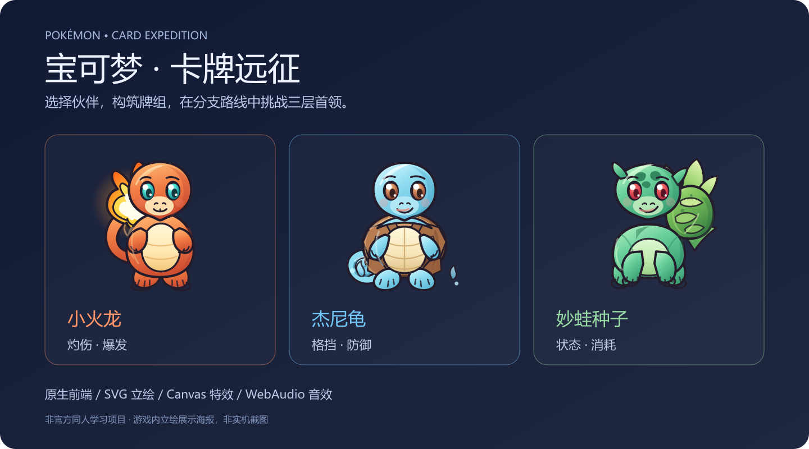
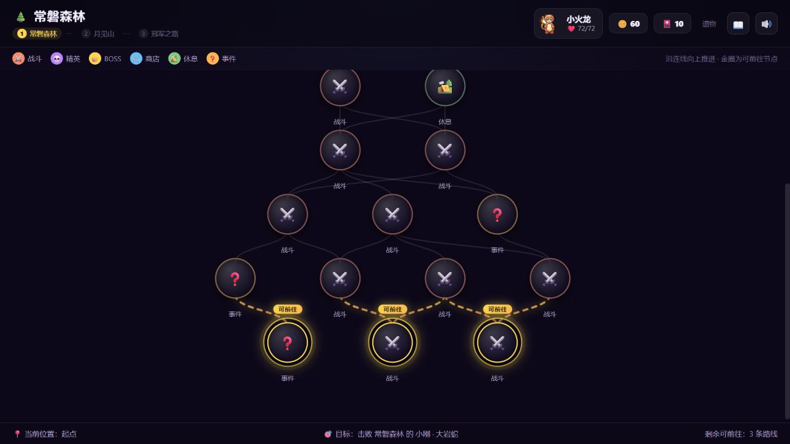
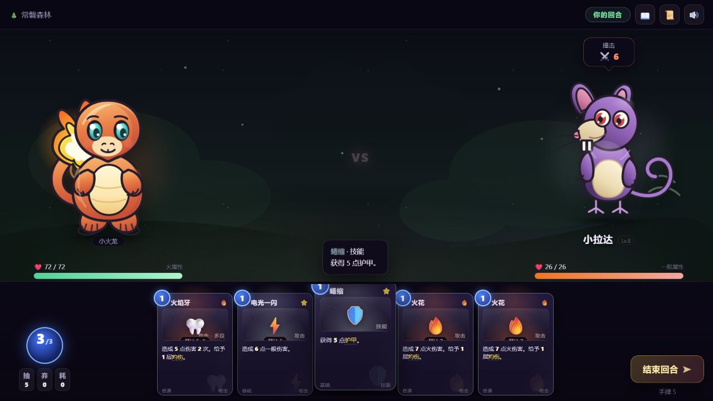
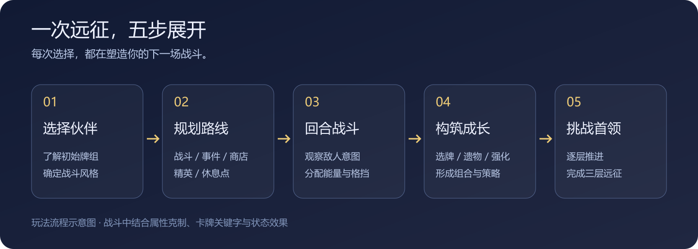

# 宝可梦 · 卡牌远征

**选择伙伴，构筑牌组，在分支路线中挑战三层首领。**

一款宝可梦主题的 Roguelike 卡牌构筑同人小游戏，玩法灵感来自《杀戮尖塔》。使用 HTML、CSS 和 JavaScript 实现，融合 SVG 立绘、Canvas 战斗特效与 WebAudio 音效，无需后端。



> 封面使用游戏内 SVG 立绘制作，是展示海报，不是实机截图。

## 开始冒险

- **在线试玩**：[打开网页版](https://xg200681.github.io/pokemon-card-expedition/)。
- **下载游玩**：选择 **Code → Download ZIP**，解压后打开 `index.html`。
- **Windows 独立窗口**：双击 `启动游戏.exe` 或 `启动游戏.bat`，使用 Edge / Chrome 打开独立应用窗口。

浏览器首次播放声音需要点击交互，游戏内可关闭音效。当前版本没有持久存档，刷新或关闭页面后需要重新开始。

## 实机画面

以下截图采自已上线的 GitHub Pages 版本。

**路线规划**：金色圆环标记当前可前往的节点，根据生命与牌组情况选择下一站。



**回合战斗**：上方观察敌人意图，下方使用手牌与能量，兼顾攻击、格挡和状态效果。



## 怎么玩



1. **选择伙伴**：小火龙偏向灼伤与爆发，杰尼龟偏向防御，妙蛙种子偏向持续消耗。
2. **规划路线**：在战斗、精英、事件、商店与休息点之间选择，地图会高亮可前往的节点。
3. **观察意图**：敌人会提前展示行动。分配每回合的能量，在攻击、格挡和状态效果之间做取舍。
4. **构筑成长**：战后选牌、收集遗物，在商店调整牌组，在休息点回复生命或强化卡牌。
5. **挑战首领**：逐层推进，击败三层首领，完成本次远征。

## 特色系统

| 系统 | 内容 |
| --- | --- |
| 卡牌构筑 | 攻击、技能、能力牌，以及消耗、保留、虚无、固有、多段、X 费关键字 |
| 战斗策略 | 属性克制、敌人意图、力量、敏捷、中毒、灼伤、易伤等状态 |
| 角色表现 | SVG 角色立绘、属性光环、呼吸动画与首领标识 |
| 战斗反馈 | 元素弹道、命中粒子、伤害数字、屏幕闪光与程序化音效 |
| 地图探索 | 随机分支路线、精英、商店、休息点与随机事件 |
| 牌组管理 | 选牌、移除、强化，以及抽牌堆、弃牌堆和消耗堆查看 |

## 演示解说词

> 这是一款宝可梦主题的卡牌构筑小游戏《宝可梦·卡牌远征》。我们先选择初始伙伴，每个伙伴都有不同的起始牌组和战斗风格。进入地图后，可以根据生命值和牌组情况规划路线：挑战敌人获得奖励，前往商店调整牌组，或者在休息点恢复与强化。战斗中，敌人的下一步行动会提前显示，我们要合理使用每回合的能量，平衡攻击和防御，并利用属性克制与状态效果取得优势。随着卡牌和遗物逐渐成型，最终目标是突破三层区域，击败首领，完成远征。

完整的分镜、画面提示与发布配文见 [演示解说词](docs/解说词.md)，可用于录屏介绍或项目展示。

## 项目结构

```text
index.html             页面入口
css/style.css          界面样式与动画
js/data.js             卡牌、敌人、遗物、事件和楼层数据
js/art.js               立绘注册与渲染
js/art/*.js             SVG 角色立绘
js/fx.js                Canvas 特效与 WebAudio 音效
js/battle.js            战斗规则与卡牌结算
js/map.js               地图生成与路线导航
js/ui.js                界面渲染
js/game.js              游戏状态
js/main.js              游戏流程入口
bundle.js               浏览器实际加载的打包文件
Launcher.cs             Windows 启动器源代码
scripts/                展示图生成脚本
docs/                  展示图与演示解说词
```

## 开发

运行现有版本不需要安装依赖。修改 `js/` 后，安装 Node.js 并重新打包：

```powershell
npx esbuild js/main.js --bundle --format=iife --outfile=bundle.js --charset=utf8 --target=es2019
```

CSS 由页面直接加载，修改后刷新即可。如果浏览器仍使用旧内容，请强制刷新。项目目前没有后端、账号系统或联机模式。

## 项目与素材说明

本项目用于学习交流，是非官方同人作品，与 Pokémon、Nintendo、Game Freak 或 Creatures 无关联。宝可梦相关角色、名称与商标属于各自权利人；本仓库不授予这些第三方内容的使用权。仓库目前未附开源许可证，公开展示不代表授予代码或素材的再分发许可。

